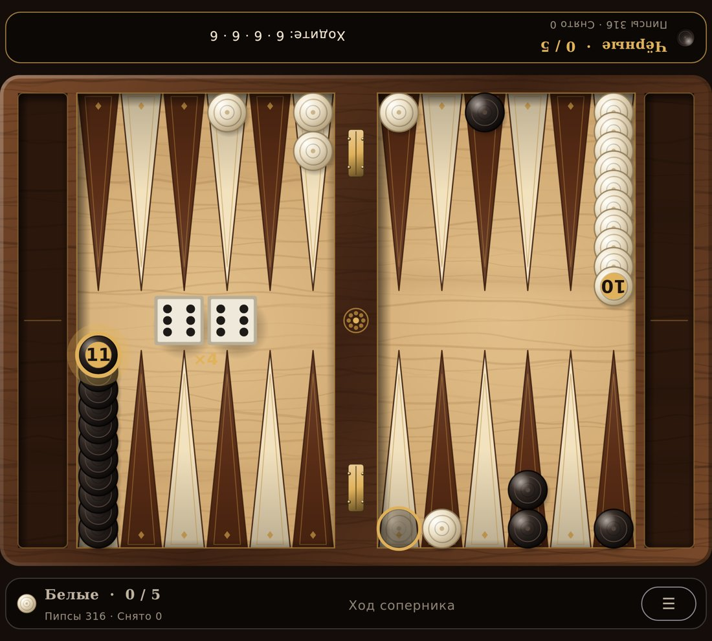
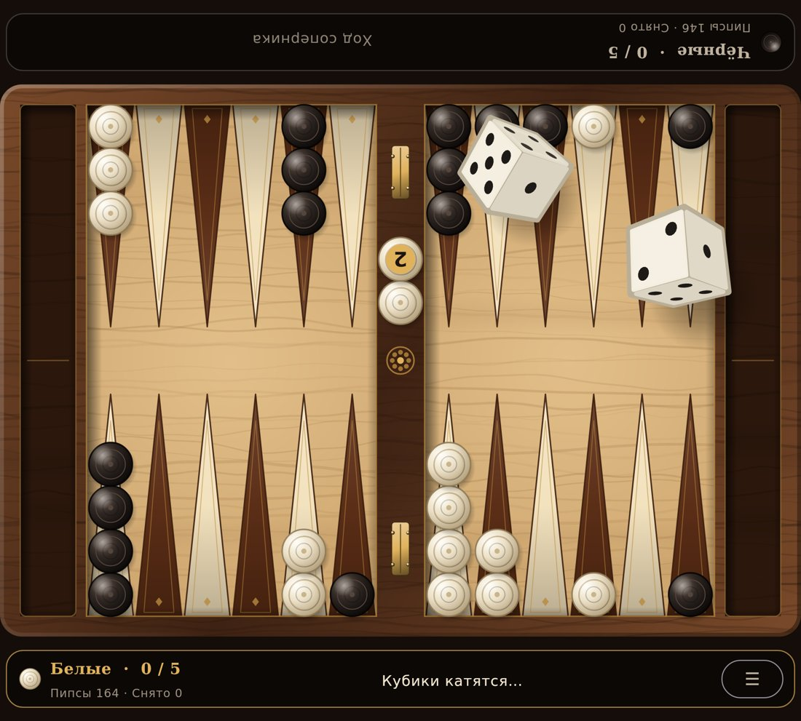
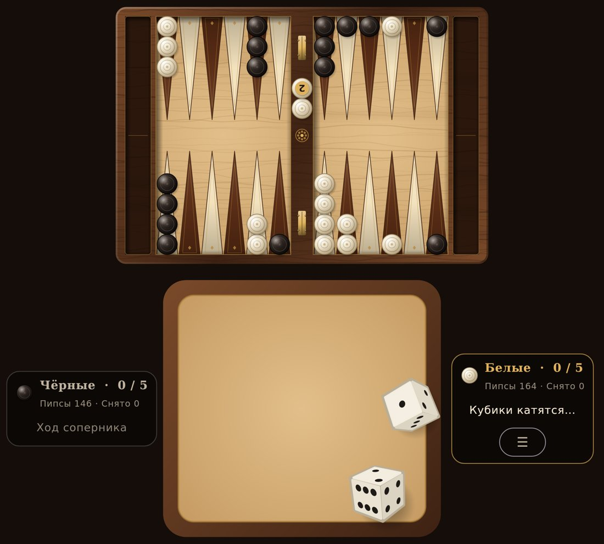
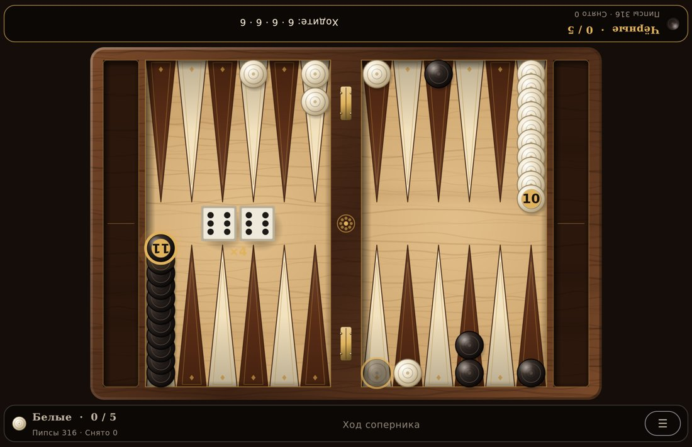
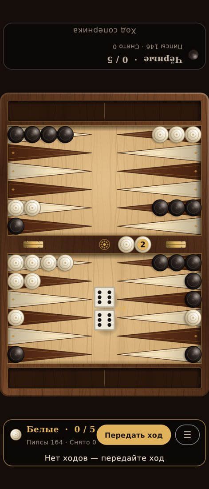
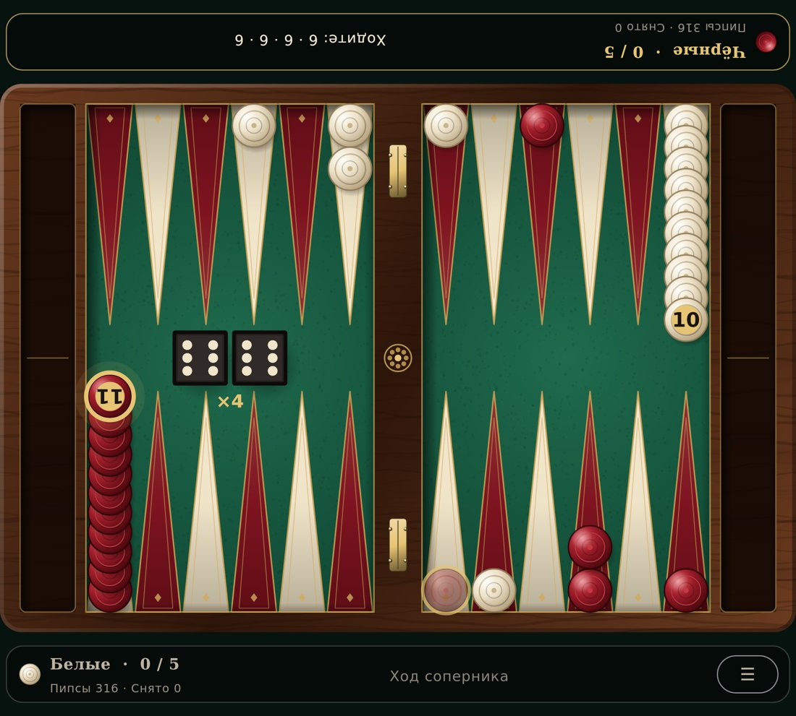
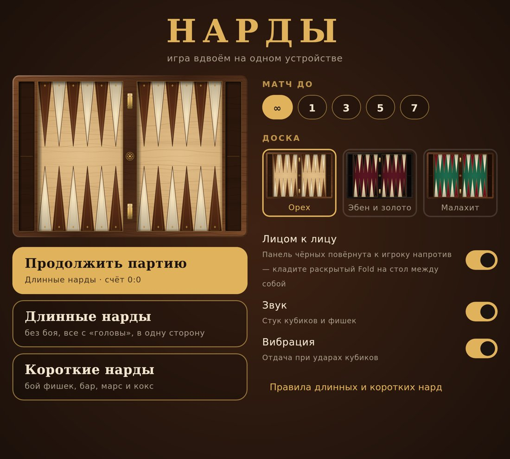

# Нарды (Android, Kotlin + Jetpack Compose)

Длинные и короткие нарды на двоих на одном устройстве, без интернета.
Основная платформа — **Samsung Galaxy Fold 7**, но игра подстраивается под
любой экран: от обложки складного телефона до планшета и двухэкранных
устройств.

## Скриншоты

Внутренний экран Fold 7 — выбрана шашка, подсвечены ходы · кубики в полёте:

 

Flex-режим (лоток для кубиков внизу) · двухэкранный режим (бар над шарниром):

 

Обложка в портрете · тема «Малахит» · меню:

  

## Что внутри

- **Два вида нард**:
  - *Длинные*: все шашки на «голове», ход в одну сторону, без боя. С головы
    снимается одна шашка за ход, на первом броске 6-6 / 4-4 / 3-3 — две.
    Запрещён блок из шести шашек подряд, если впереди него нет шашки соперника.
  - *Короткие* (бэкгаммон): бой блотов, бар, вход в дом соперника.
  - Общие правила: дубль играется 4 раза; если можно сыграть оба кубика,
    нужно сыграть оба, если только один — больший; выбрасывание с большим
    кубиком только с самого дальнего пункта.
  - Очки: ойн (1), марс (2), кокс (3, в коротких). Матч до 1/3/5/7 очков или
    бесконечная серия.
- **Кубики бросаются пальцем**: прижмите палец — кубики «в руке» гремят,
  смахните — и они летят по доске с физикой: скользят, подпрыгивают,
  отскакивают от бортов и друг от друга, кувыркаются в настоящем 3D
  (перспективная проекция, освещение, тени). Сила броска зависит от
  скорости жеста. Результат выбирается честным `SecureRandom` до броска,
  физика лишь «докатывает» кубик до нужной грани.
- **Красивая доска без единой картинки**: всё рисуется процедурно —
  текстура дерева/сукна, инкрустированные пункты, латунные петли, розетка на
  баре, точёные фишки с гравировкой и бликом. Поэтому доска одинаково чёткая
  на любом экране. Три темы: «Орех», «Эбен и золото», «Малахит».
- **Управление шашками**: тап по шашке подсвечивает все пункты, куда она может
  пойти (в т.ч. на сумму кубиков одним касанием), тап по пункту — ход. Можно
  просто перетащить шашку пальцем. Отмена хода (↶) до нажатия «Готово».
- **Розыгрыш первого хода**: белый и чёрный кубик, у кого больше — тот начинает.
- Звук (синтезируется в коде, без аудиофайлов) и вибрация на ударах кубиков.
- Партия сохраняется автоматически — можно закрыть приложение и продолжить.

## Адаптация под складные и двухэкранные устройства

Раскладка выбирается по размеру окна и данным Jetpack WindowManager о сгибе
(`FoldingFeature`), см. `ui/screen/GameLayout.kt`:

| Положение | Что происходит |
|---|---|
| Fold 7, внутренний экран раскрыт | Доска во весь экран, панели игроков сверху и снизу. Режим **«лицом к лицу»**: панель чёрных повёрнута на 180° — кладёте телефон на стол между собой и играете как за настоящей доской. |
| Fold 7, обложка (портрет) | Доска поворачивается на 90°, чтобы занять высокий экран. |
| Fold 7, обложка (ландшафт) | Доска по высоте, панели игроков слева и справа. |
| **Flex-режим** (полураскрыт, сгиб горизонтально) | Доска на верхней половине, нижняя половина превращается в суконный **лоток для кубиков**. |
| Полураскрыт «книжкой» / двухэкранные устройства (Surface Duo и т.п.) | Бар доски растягивается ровно поверх шарнира — ни один пункт не попадает на сгиб. |

Сгиб/разгиб не пересоздаёт активность (`configChanges` в манифесте), а
состояние игры живёт во `ViewModel`, поэтому бросок или выбранная шашка
не теряются при складывании.

> iPhone: APK на iOS не ставится. Правила игры вынесены в отдельный модуль
> на чистом Kotlin (`engine/`), а вся отрисовка — на Compose без Android-API,
> так что порт на iOS через Compose Multiplatform возможен без переписывания
> логики и графики.

## Структура

- `engine/` — правила на чистом Kotlin (без Android): позиция, генерация
  ходов, все ограничения длинных и коротких нард, подсчёт очков, сохранение.
  Покрыт юнит-тестами (`./gradlew :engine:test`), включая прогон сотни
  случайных партий до конца.
- `app/src/main/java/com/bizoneceo/nardy/ui/board` — геометрия доски, темы,
  процедурная отрисовка доски и фишек.
- `.../ui/dice` — 3D-математика (кватернионы), физика броска, отрисовка кубика.
- `.../ui/screen` — раскладки под устройства, контроллер жестов и анимаций,
  экран партии, меню.
- `.../platform` — Android: сгиб экрана, звук/вибрация, сохранение.

## Сборка

APK собирается в GitHub Actions (`.github/workflows/build-nardy.yml`) и
выкладывается в релиз `nardy-apk-latest` — файл `nardy-debug.apk`.

Локально (нужен Android SDK):

```
cd nardy
./gradlew :engine:test :app:assembleDebug
```
